# Drone Agri Segmentation — Full Pipeline

 ## 1. Project Setup & Data Prep

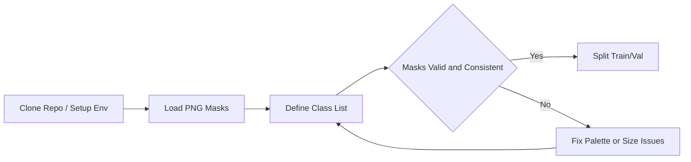

---

 ## 2. Training Workflow

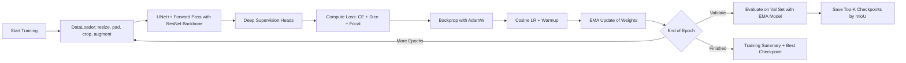

---

 ## 3. AI Segmentation Training Workflow
   
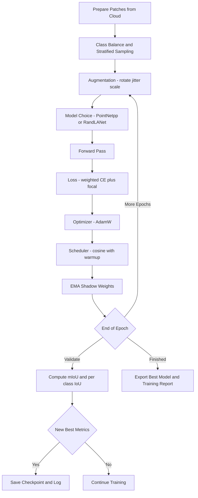

 ## 4. Inference and Reconstruction Sequence

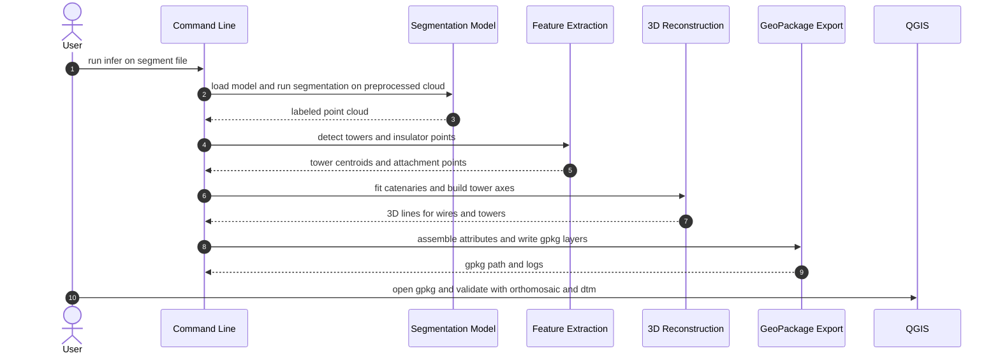

 ## 5.  Feature Extraction Detail

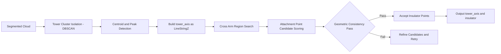

 ## 6.  Wire Fitting Logic

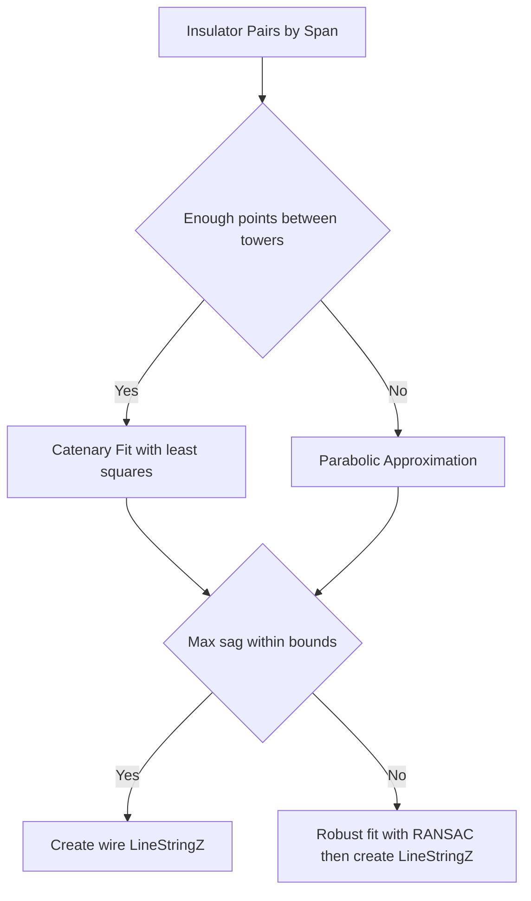

 ## 7. Export and Validation

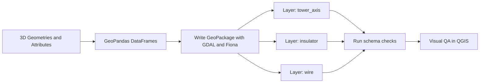

 ## 8. Quality Gates and Error Handling State Machine

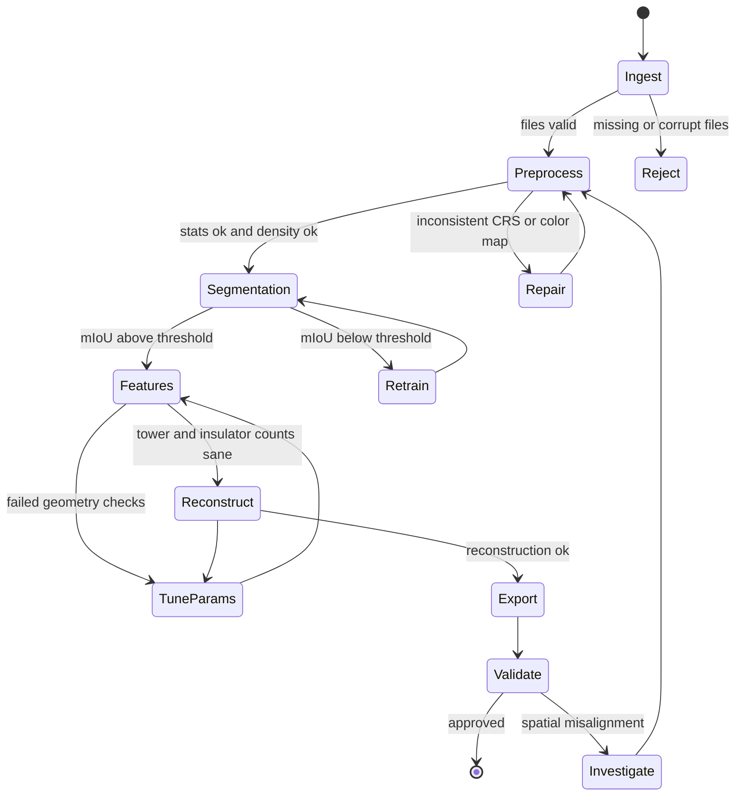

 ## 9. GeoPackage Schema as ER Diagram

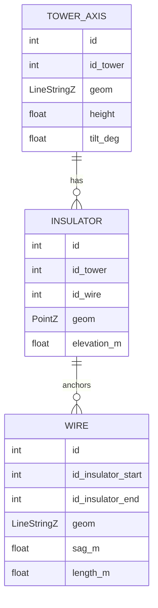

 ## 10. Orchestration and Parallelization DAG

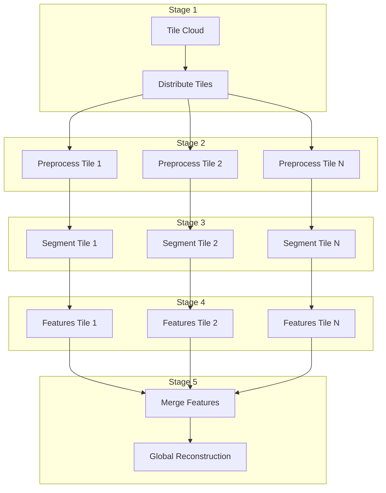

 ## 11. CI and Reproducibility Pipeline

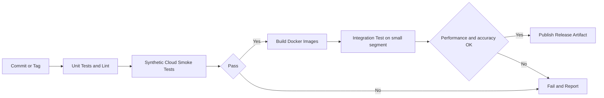

 ## 12. Data Lineage and Provenance

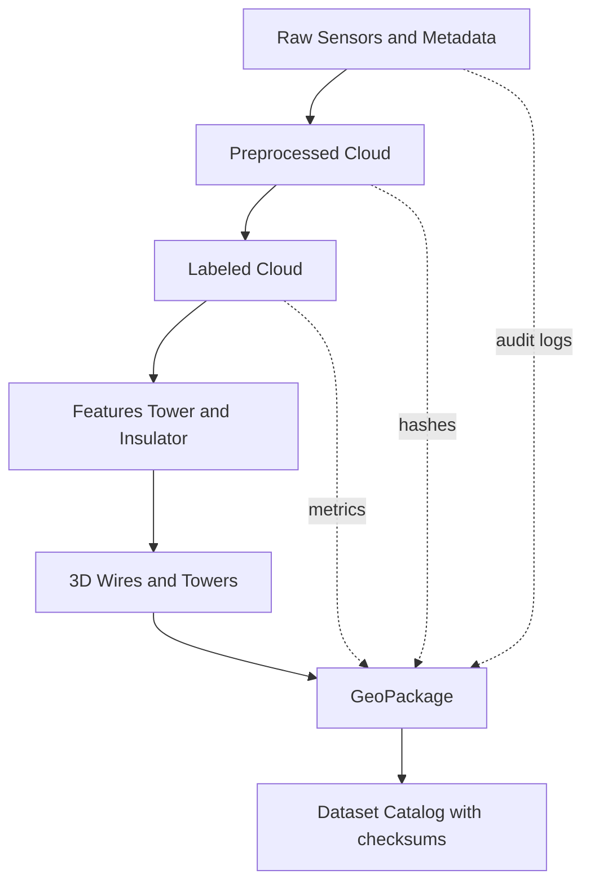

 ## 13. Stakeholder Journey Diagram

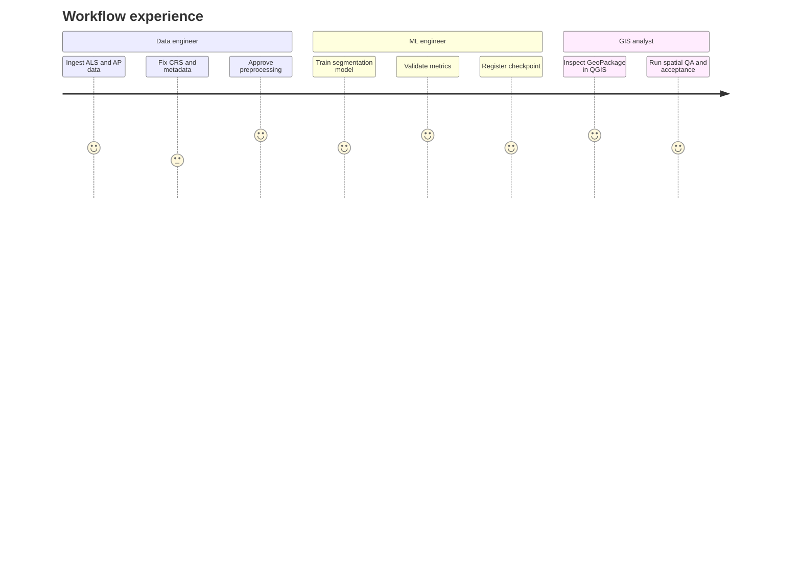

 ## 14. November 2025 Project Gantt

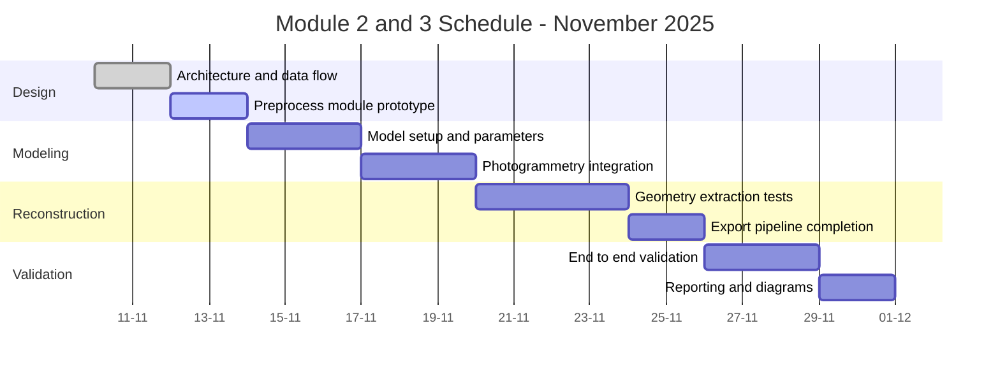

 ## 15. Innovative Hybrid Segmentation Diagram

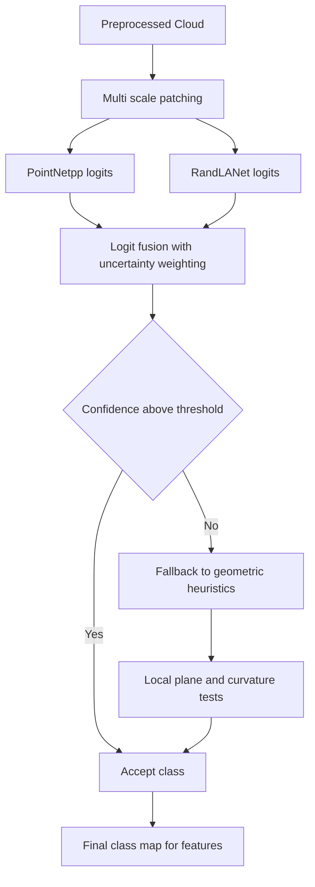

 ## 16. Robustness and Recovery Loop
    
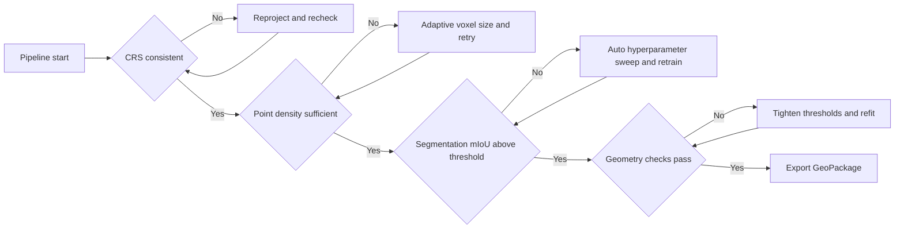

 ## 17. Minimal Examples for Quick Testing

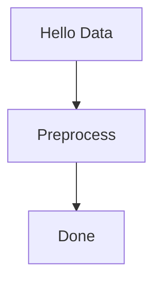
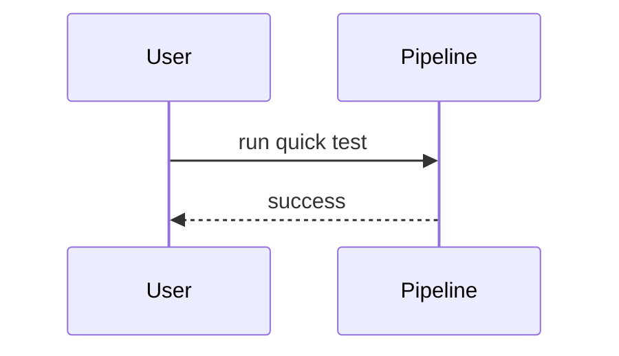
