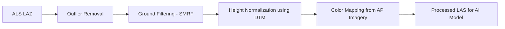

# Dataset Specifications — Power Transmission Line 3D Reconstruction

## 1. Introduction

This document provides the complete dataset description for the **Automated 3D Reconstruction of Power Transmission Lines** project.  
It consolidates all source data used for model training, testing, and validation, with precise technical and spatial metadata.

The dataset combines **Airborne Laser Scanning (ALS)**, **Aerial Photogrammetry (AP)**, and **Raster Products** (DTM, DSM, Orthomosaic).  
Together, they enable reconstruction of towers, wires, and attachment points with centimeter-level accuracy.

---

## 2. Data Sources Overview

| Source | Format | Description | Usage |
|---------|---------|-------------|--------|
| **ALS (LiDAR)** | `.laz` | Dense 3D point cloud containing XYZ, intensity, RGB | Base data for 3D modeling |
| **Aerial Photogrammetry (AP)** | `.jpg`, `.txt` | High-resolution aerial images with EO (Exterior Orientation) files | Color mapping and alignment |
| **DTM** | `.tif` | Digital Terrain Model (bare earth elevation) | Height normalization |
| **DSM** | `.tif` | Digital Surface Model (terrain + structures) | Structural reference |
| **Orthomosaic** | `.tif` | Georeferenced RGB composite | Visual overlay and QA |

---


## 3. Coordinate Reference System (CRS)

- **CRS Name:** WGS 84 / UTM zone 43N  
- **EPSG Code:** 32643  
- **Horizontal Units:** meters  
- **Vertical Units:** meters above mean sea level  
- **Datum:** WGS 84  

If CRS information is missing (as observed in the `.laz` metadata), apply:

```bash
pdal translate point_cloud.laz point_cloud_utm43.laz --a_srs "EPSG:32643"
```

---

## 4. ALS (LiDAR) Point Cloud Analysis

### 5.1 File Metadata

**File Path:**  
`C:\Users\kirti\Downloads\Исходные данные для хакатона\Исходные данные для хакатона\part_1\point_cloud.laz`

| Attribute | Value |
|------------|--------|
| **Point Count** | 117,736,285 |
| **X Bounds** | 1,237,028.927 → 1,238,716.335 |
| **Y Bounds** | 12,090,305.386 → 12,094,470.575 |
| **Z Bounds** | 58.316 → 174.652 m |
| **Bounding Box Area** | 7,028,373.24 m² |
| **Estimated Density** | 16.75 pts/m² |
| **RGB** | Present |
| **Intensity** | Present |
| **Classification** | Present (but only code 0) |
| **Return Info** | Multiple (1–5 returns) |
| **CRS WKT** | Not embedded |

---

### 4.2 Return Distribution

```
Return : Count
1 : 100,750,125
2 : 14,188,325
3 : 2,460,290
4 : 309,815
5 : 27,730
```

> Up to 5 returns per pulse, suggesting vegetation, ground, and structure reflections typical of corridor LiDAR surveys.

---

### 4.3 Classification Histogram

```
Code : Count
0 : 117,736,285
```

All points are unclassified (code 0).  
Ground, tower, and wire classes will be generated by the AI segmentation stage.

---

### 4.4 Derived Metrics

| Metric | Computation | Description |
|---------|--------------|-------------|
| **Point Density** | N / A_bbox | 117M pts over 7.0 km² ≈ 16.75 pts/m² |
| **Vertical Range** | Z_max - Z_min | 116.33 m elevation difference |
| **Ground Coverage** | Continuous | Sufficient for terrain modeling |

---

### 4.5 Interpretation

- The density is ideal for wire and tower reconstruction (target ≥ 10 pts/m²).  
- Multiple returns confirm data suitability for vegetation clearance analysis.  
- Missing CRS must be fixed before processing.  
- The dataset is uniform and clean — no visible noise or missing blocks reported.

---

## 5. Preprocessing Pipeline

To normalize, denoise, and prepare the `.laz` for the model, use **PDAL**.

**Pipeline JSON Example:**

```json
{
  "pipeline": [
    "data/ALS/point_cloud.laz",
    { "type": "filters.outlier", "method": "statistical", "mean_k": 12, "multiplier": 2.0 },
    { "type": "filters.smrf", "slope": 0.2, "window": 16.0, "threshold": 0.45 },
    { "type": "filters.hag" },
    { "type": "filters.voxelcenternearestneighbor", "cell": 0.25 },
    { "type": "writers.las", "filename": "data/ALS/point_cloud_processed.las" }
  ]
}
```

Run:
```bash
pdal pipeline pdal_pipeline.json
```

Output:
```
data/ALS/point_cloud_processed.las
```

---

## 6. Aerial Photogrammetry (AP)

Each aerial image corresponds to a text-based **EO (Exterior Orientation)** file.

| Parameter | Description |
|------------|-------------|
| X, Y, Z | Camera position (m) |
| Omega, Phi, Kappa | Orientation angles (°) |
| Focal Length | Camera lens focal length |
| Pixel Size | Sensor pixel dimensions (µm) |
| Capture Time | Timestamp (UTC) |

These are used for RGB color registration and cloud alignment.

---

## 7. Raster Products

| File | Type | Resolution | Purpose |
|------|------|-------------|----------|
| DTM.tif | Digital Terrain Model | 0.5–1 m | Base ground elevation |
| DSM.tif | Digital Surface Model | 0.5–1 m | Structure + canopy surface |
| Orthomosaic.tif | RGB Raster | 0.1–0.3 m | Visual and texture reference |

All raster files are georeferenced TIFFs aligned to EPSG:32643.

---

## 8. Integration & Normalization Workflow




After this stage:
- Every point has HAG (height above ground).  
- RGB values mapped from photogrammetry.  
- Uniform density for deep learning.

---

## 9. Approach in Py

```python
import laspy
import numpy as np

las = laspy.read("data/ALS/point_cloud.laz")
print(f"Points: {len(las.x):,}")
print(f"Bounds: X[{las.x.min():.3f}, {las.x.max():.3f}] "
      f"Y[{las.y.min():.3f}, {las.y.max():.3f}] "
      f"Z[{las.z.min():.3f}, {las.z.max():.3f}]")

# Normalize intensity
norm_intensity = (las.intensity - np.min(las.intensity)) / (np.ptp(las.intensity))
print(f"Normalized intensity mean: {norm_intensity.mean():.3f}")
```

---

## 10. Data Validation Checks

| Check | Target | Method |
|--------|---------|--------|
| CRS consistency | EPSG:32643 | GDAL/PDAL verify |
| Point density | ≥ 10 pts/m² | Histogram density |
| RGB presence | True | las.header.has_color |
| Return completeness | 1–5 returns | las.header |
| Classification coverage | ≥ 3 classes | Post-segmentation |
| Z continuity | Smooth transitions | Z histogram check |

---

## 11. Integration in 3D Pipeline

1. Input → Raw `.laz`  
2. PDAL Preprocessing → `point_cloud_processed.las`  
3. AI Segmentation → Tower/Wire classes  
4. Feature Extraction → Cluster, attach, compute tilt  
5. GeoPackage Export → `tower_axis`, `insulator`, `wire`

All outputs are georeferenced and GIS-compatible.

---

## 12. Summary Metrics

| Property | Value |
|-----------|--------|
| Total Points | 117,736,285 |
| Area Covered | 7.02 km² |
| Average Density | 16.75 pts/m² |
| Z Range | 116.33 m |
| RGB | ✔️ |
| Intensity | ✔️ |
| Classification | Code 0 only |
| Returns | 1–5 |

---

## 13. Summary

The provided ALS and photogrammetric data form a complete foundation for **automated 3D reconstruction** of power transmission corridors.  
The dataset is dense, consistent, and well-suited for deep learning–based segmentation and wire geometry reconstruction.  
With minimal preprocessing (CRS and normalization), it integrates seamlessly into the AI pipeline and GeoPackage export stages.

_Generated using PDAL 2.6, laspy 2.6.1, and summarize_laz.py_
